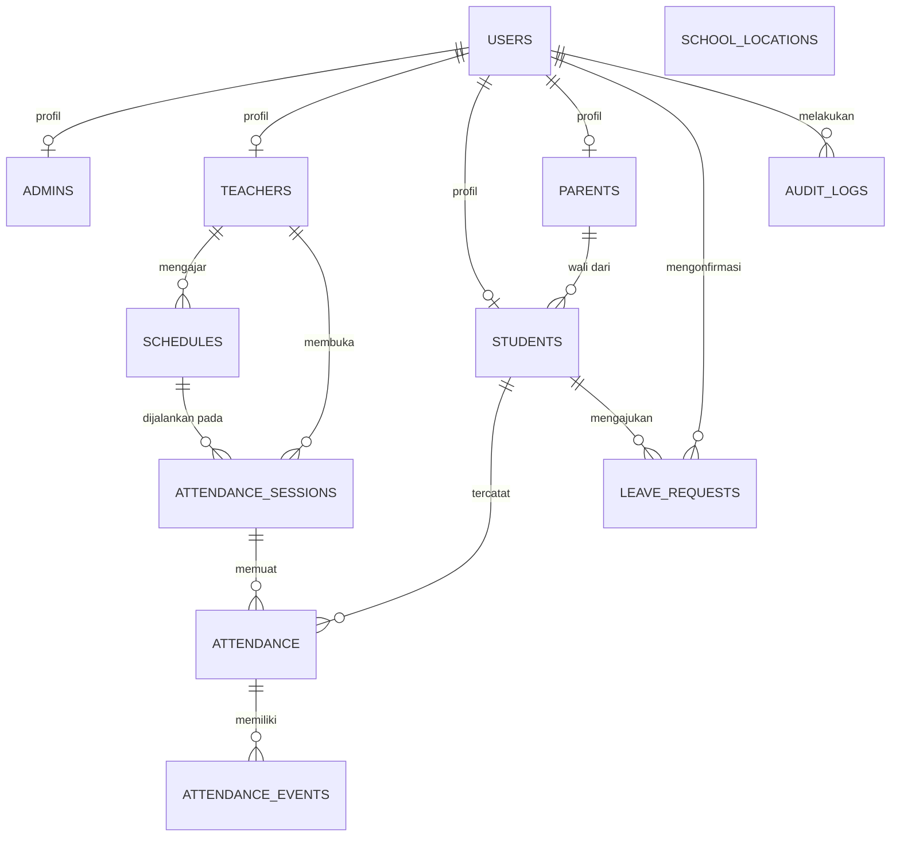

# Dokumentasi Database

Sistem Absensi Digital Siswa SMK Putra Perdana Indonesia. Dokumen ini menjelaskan rancangan database PostgreSQL yang dipetakan dari class diagram SRS (Gambar 13, bagian 3.4) dan dikelola dengan Prisma.

> **Sumber kebenaran:** `prisma/schema.prisma`. Jika dokumen ini berbeda dengan schema, schema yang berlaku. Perbarui dokumen ini setiap kali ada migrasi yang mengubah struktur.

## 1. Ringkasan

| Item | Nilai |
|---|---|
| DBMS | PostgreSQL |
| ORM | Prisma 7 (driver adapter `@prisma/adapter-pg`) |
| Penamaan tabel/kolom | `snake_case`, tabel jamak (`users`, `attendance_sessions`) |
| Penyimpanan waktu | UTC (`timestamp`), dikonversi ke `Asia/Jakarta` di lapisan aplikasi |
| Primary key | `id` integer auto-increment |
| Penghapusan data | Tidak menghapus akun secara fisik, gunakan `is_active = false` |

## 2. Perubahan dari Class Diagram SRS

Rancangan mengikuti class diagram SRS, dengan tambahan berikut yang diperlukan agar kebutuhan fungsional bisa terpenuhi. **Tambahan ini perlu disepakati tim** dan sebaiknya dicatat sebagai revisi SRS.

| Tambahan | Alasan | Kebutuhan |
|---|---|---|
| `schedules.teacher_id` | Sistem harus mencocokkan jadwal dengan guru yang membuka sesi | FR-03, FR-04 |
| `attendance_sessions.expires_at` | QR Code kedaluwarsa agar tidak bisa dipakai dari luar jam pelajaran | FR-04, NFR-06 |
| `attendance.monitoring_status` | Menyimpan hasil pemantauan lokasi terpisah dari status kehadiran | FR-10 |
| `attendance_events.accuracy_m`, `inside_radius`, `distance_m` | Bukti validasi GPS dan bahan penelusuran jika ada sengketa | FR-06, NFR-06 |
| Tabel `leave_requests` | Pengajuan izin/sakit memerlukan proses konfirmasi, tidak ada di class diagram | FR-11 |
| Tabel `audit_logs` | Pencatatan aktivitas pengguna | FR-18, NFR-02 |

## 3. Diagram Relasi (ERD)



`school_locations` berdiri sendiri. Sistem memakai lokasi yang `is_active = true` untuk validasi geofencing.

## 4. Enum

| Enum | Nilai | Keterangan |
|---|---|---|
| `Role` | `ADMIN`, `TEACHER`, `STUDENT`, `PARENT` | Satu akun hanya satu peran |
| `SessionStatus` | `ACTIVE`, `CLOSED` | Status sesi absensi |
| `AttendanceStatus` | `HADIR`, `TERLAMBAT` | Ditentukan otomatis oleh server |
| `MonitoringStatus` | `TERPANTAU`, `KELUAR_AREA`, `TIDAK_TERPANTAU` | **Belum dipakai** sejak pemantauan berkala diganti absen selesai; disimpan untuk pengembangan berikutnya |
| `EventType` | `CHECK_IN`, `CHECK_OUT`, `HEARTBEAT` | Jenis kejadian lokasi (`HEARTBEAT` belum dipakai) |
| `LeaveType` | `IZIN`, `SAKIT` | Jenis pengajuan |
| `LeaveStatus` | `PENDING`, `APPROVED`, `REJECTED` | Status konfirmasi pengajuan |

## 5. Struktur Tabel

Tanda: **PK** primary key, **FK** foreign key, **UQ** unique, **NN** not null.

### 5.1 `users`
Akun login untuk semua peran.

| Kolom | Tipe | Constraint | Keterangan |
|---|---|---|---|
| id | integer | PK | |
| username | varchar | UQ, NN | |
| password_hash | text | NN | Hash argon2, jangan simpan password asli |
| role | Role | NN | |
| is_active | boolean | NN, default `true` | Nonaktifkan akun alih-alih menghapus |
| created_at | timestamp | NN, default now | |

### 5.2 `admins`
| Kolom | Tipe | Constraint | Keterangan |
|---|---|---|---|
| id | integer | PK | |
| user_id | integer | FK → users.id, UQ, NN | Relasi 1:1 |
| name | varchar | NN | |

### 5.3 `teachers`
| Kolom | Tipe | Constraint | Keterangan |
|---|---|---|---|
| id | integer | PK | |
| user_id | integer | FK → users.id, UQ, NN | |
| nip | varchar | UQ, NN | |
| name | varchar | NN | |

### 5.4 `parents`
| Kolom | Tipe | Constraint | Keterangan |
|---|---|---|---|
| id | integer | PK | |
| user_id | integer | FK → users.id, UQ, NN | |
| name | varchar | NN | |

### 5.5 `students`
| Kolom | Tipe | Constraint | Keterangan |
|---|---|---|---|
| id | integer | PK | |
| user_id | integer | FK → users.id, UQ, NN | |
| parent_id | integer | FK → parents.id, nullable | Satu orang tua bisa memiliki banyak siswa |
| nis | varchar | UQ, NN | |
| name | varchar | NN | |
| class_name | varchar | NN | Contoh: `XI RPL 1` |

### 5.6 `schedules`
Jadwal mengajar per kelas dan mata pelajaran.

| Kolom | Tipe | Constraint | Keterangan |
|---|---|---|---|
| id | integer | PK | |
| teacher_id | integer | FK → teachers.id, NN | Tambahan dari class diagram |
| class_name | varchar | NN | Sama dengan `students.class_name` |
| subject | varchar | NN | |
| day | smallint | NN | 1 = Senin ... 7 = Minggu |
| start_time | time | NN | Waktu lokal sekolah |
| end_time | time | NN | Harus lebih besar dari `start_time` |

### 5.7 `school_locations`
| Kolom | Tipe | Constraint | Keterangan |
|---|---|---|---|
| id | integer | PK | |
| name | varchar | NN | |
| latitude | decimal(10,7) | NN | |
| longitude | decimal(10,7) | NN | |
| radius_m | integer | NN | Radius geofencing dalam meter |
| is_active | boolean | NN, default `true` | Hanya satu lokasi aktif pada satu waktu (dijaga di aplikasi) |

### 5.8 `attendance_sessions`
Sesi absensi yang dibuka guru, berisi token QR.

| Kolom | Tipe | Constraint | Keterangan |
|---|---|---|---|
| id | integer | PK | |
| teacher_id | integer | FK → teachers.id, NN | |
| schedule_id | integer | FK → schedules.id, NN | |
| qr_token | varchar | UQ, NN | Token acak (minimal 32 byte, base64url) |
| opened_at | timestamp | NN, default now | Dipakai sebagai acuan batas terlambat |
| expires_at | timestamp | NN | Tambahan dari class diagram |
| status | SessionStatus | NN, default `ACTIVE` | |

### 5.9 `attendance`
Satu baris per siswa per sesi.

| Kolom | Tipe | Constraint | Keterangan |
|---|---|---|---|
| id | integer | PK | |
| session_id | integer | FK → attendance_sessions.id, NN | |
| student_id | integer | FK → students.id, NN | |
| check_in_at | timestamp | nullable | Waktu server |
| check_out_at | timestamp | nullable | Waktu server |
| status | AttendanceStatus | NN | |
| monitoring_status | MonitoringStatus | NN, default `TERPANTAU` | Tambahan dari class diagram; belum dipakai (lihat bagian 7 poin 7a) |

Constraint tambahan: **UQ (`session_id`, `student_id`)** untuk mencegah check-in ganda (FR-07).

### 5.10 `attendance_events`
Catatan lokasi tiap kejadian (absen masuk dan absen selesai).

| Kolom | Tipe | Constraint | Keterangan |
|---|---|---|---|
| id | integer | PK | |
| attendance_id | integer | FK → attendance.id, NN | |
| event_type | EventType | NN | |
| recorded_at | timestamp | NN, default now | Waktu server |
| latitude | decimal(10,7) | NN | |
| longitude | decimal(10,7) | NN | |
| accuracy_m | float | nullable | Akurasi GPS dari browser |
| distance_m | float | nullable | Jarak ke titik sekolah hasil hitung server |
| inside_radius | boolean | NN | Hasil validasi geofencing |

### 5.11 `leave_requests`
Pengajuan izin atau sakit.

| Kolom | Tipe | Constraint | Keterangan |
|---|---|---|---|
| id | integer | PK | |
| student_id | integer | FK → students.id, NN | |
| type | LeaveType | NN | |
| date_from | date | NN | |
| date_to | date | NN | Sama dengan `date_from` jika satu hari |
| reason | text | NN | |
| status | LeaveStatus | NN, default `PENDING` | |
| reviewed_by | integer | FK → users.id, nullable | Pihak yang mengonfirmasi |
| reviewed_at | timestamp | nullable | |
| created_at | timestamp | NN, default now | |

### 5.12 `audit_logs`
| Kolom | Tipe | Constraint | Keterangan |
|---|---|---|---|
| id | integer | PK | |
| user_id | integer | FK → users.id, nullable | Kosong jika login gagal tanpa akun dikenal |
| action | varchar | NN | Contoh: `LOGIN`, `LOGOUT`, `STUDENT_CREATE`, `SESSION_OPEN` |
| entity | varchar | nullable | Nama tabel terkait |
| entity_id | integer | nullable | |
| detail | jsonb | nullable | Data tambahan, jangan simpan password atau token |
| ip_address | varchar | nullable | |
| created_at | timestamp | NN, default now | |

## 6. Index yang Disarankan

| Tabel | Index | Tujuan |
|---|---|---|
| users | UQ `username` | Login |
| students | UQ `nis`, index `class_name` | Pencarian dan rekap per kelas |
| teachers | UQ `nip` | |
| attendance_sessions | UQ `qr_token`, index (`status`, `expires_at`) | Validasi token QR saat scan |
| attendance_sessions | index (`schedule_id`, `opened_at`) | Riwayat sesi per jadwal |
| attendance | UQ (`session_id`, `student_id`) | Cegah duplikasi |
| attendance | index (`student_id`, `check_in_at`) | Riwayat siswa dan orang tua |
| attendance_events | index (`attendance_id`, `recorded_at`) | Riwayat lokasi per absensi |
| leave_requests | index (`student_id`, `date_from`) | |
| audit_logs | index (`user_id`, `created_at`) | Penelusuran aktivitas |

## 7. Aturan Integritas dan Bisnis

1. **Satu akun satu peran.** `users.role` menentukan tabel profil mana yang terisi. Setiap tabel profil memiliki `user_id` unik, dan aplikasi memastikan peran sesuai.
2. **Waktu selalu dari server.** `check_in_at`, `check_out_at`, dan `recorded_at` diisi server, tidak pernah diterima dari browser (NFR-03).
3. **Status terlambat.** `status = TERLAMBAT` jika `check_in_at - attendance_sessions.opened_at` lebih dari 5 menit, selain itu `HADIR` (FR-08).
4. **Geofencing di server.** Jarak dihitung dengan rumus Haversine terhadap lokasi aktif. Hasilnya disimpan di `attendance_events` (`distance_m`, `inside_radius`). Absensi dengan `inside_radius = false` ditolak dan tidak membuat baris `attendance`. Percobaan yang ditolak dicatat di `audit_logs` dengan aksi `ATTENDANCE_REJECTED` (kode alasan, jarak, dan akurasi), **tanpa** koordinat asli siswa.
4a. **Sesi absensi.** Satu sesi per jadwal per hari. `expires_at` = jam selesai jadwal pada hari itu. Sesi bisa dibuka mulai 15 menit sebelum jam mulai (`OPEN_SESSION_EARLY_MINUTES`). Jika guru menutup lalu membuka lagi di hari yang sama, sesi dan QR yang sama dipakai kembali.
5. **Tanpa penghapusan fisik.** Siswa, guru, dan akun dinonaktifkan lewat `is_active`. Relasi ke `attendance` memakai aturan **Restrict** agar riwayat tidak hilang.
6. **Cascade hanya untuk data turunan.** Menghapus `attendance` boleh menghapus `attendance_events` miliknya, tetapi tidak sebaliknya.
7. **Izin dan sakit.** Pengajuan yang berstatus `APPROVED` dibaca saat menyusun rekap, tidak membuat baris `attendance`. Siswa tanpa baris `attendance` dan tanpa izin pada hari sekolah dihitung sebagai alpa di tingkat laporan.
7a. **Absen selesai (FR-09, FR-10).** Pemantauan lokasi berkala (heartbeat) tidak dipakai. Sebagai gantinya siswa melakukan absen selesai (`check_out_at`, event `CHECK_OUT` dengan validasi radius) mulai 2/3 durasi pelajaran (`CHECKOUT_AFTER_PERCENT`, dihitung dari jam mulai jadwal) sampai `CHECKOUT_GRACE_MINUTES` (10) menit setelah pelajaran berakhir. Absen masuk ditutup saat pelajaran berakhir; `attendance_sessions.expires_at` = jam selesai + 10 menit. Siswa yang hadir tetapi `check_out_at` kosong setelah sesi berakhir ditampilkan "Tidak absen selesai" di laporan, tanpa mengubah status Hadir/Terlambat. Kolom `monitoring_status` dan nilai `HEARTBEAT` dibiarkan agar tidak perlu migrasi.
8. **Retensi data lokasi.** Koordinat hanya disimpan saat absen masuk dan absen selesai sebagai bukti absensi. Percobaan absen yang ditolak hanya mencatat jarak dan akurasi di `audit_logs`, tanpa koordinat.

## 8. Contoh Query

**Riwayat kehadiran satu siswa pada rentang tanggal** (FR-12, FR-14):

```sql
SELECT a.check_in_at, a.check_out_at, a.status, sc.subject
FROM attendance a
JOIN attendance_sessions s ON s.id = a.session_id
JOIN schedules sc ON sc.id = s.schedule_id
WHERE a.student_id = $1
  AND a.check_in_at >= $2 AND a.check_in_at < $3
ORDER BY a.check_in_at DESC;
```

**Rekap kehadiran per kelas** (FR-16). Parameter waktu dalam UTC, konversi dari `Asia/Jakarta` dilakukan di aplikasi:

```sql
SELECT st.nis, st.name,
  COUNT(*) FILTER (WHERE a.status = 'HADIR')     AS hadir,
  COUNT(*) FILTER (WHERE a.status = 'TERLAMBAT') AS terlambat
FROM students st
LEFT JOIN attendance a
  ON a.student_id = st.id
 AND a.check_in_at >= $1 AND a.check_in_at < $2
WHERE st.class_name = $3
GROUP BY st.id
ORDER BY st.name;
```

**Siswa yang hadir tetapi tidak absen selesai pada sesi tertentu** (FR-10):

```sql
SELECT st.nis, st.name, a.check_in_at
FROM attendance a
JOIN students st ON st.id = a.student_id
WHERE a.session_id = $1
  AND a.check_out_at IS NULL;
```

## 9. Data Seed (untuk Pengembangan)

Seed dijalankan agar semua anggota tim memiliki data uji yang sama.

| Data | Jumlah | Catatan |
|---|---|---|
| Admin | 1 | |
| Guru | 2 | Masing-masing dengan 1-2 jadwal |
| Orang tua | 2 | |
| Siswa | 5-10 | Beberapa dihubungkan ke orang tua |
| Lokasi sekolah | 1 | Koordinat contoh, radius misalnya 100 m |

Password akun seed hanya untuk development dan **tidak boleh dipakai di production**.

## 10. Hal yang Perlu Disepakati

- [ ] Tambahan struktur di bagian 2 disetujui tim dan dicatat sebagai revisi SRS.
- [x] Siapa yang mengonfirmasi izin/sakit: **Admin TU**. `leave_requests.reviewed_by` berisi id user admin.
- [x] Definisi "keluar area": **diganti absen selesai** setelah 2/3 pelajaran (lihat bagian 7 poin 7a). Perlu dikonfirmasi ke dosen dan pihak sekolah.
- [x] Batas akurasi GPS maksimum: **50 m**, diatur lewat `MAX_GPS_ACCURACY_M`.
- [x] Masa retensi data lokasi `HEARTBEAT`: tidak relevan lagi karena heartbeat tidak dipakai.
- [ ] Apakah satu siswa bisa terhubung ke lebih dari satu orang tua (saat ini hanya satu `parent_id`).